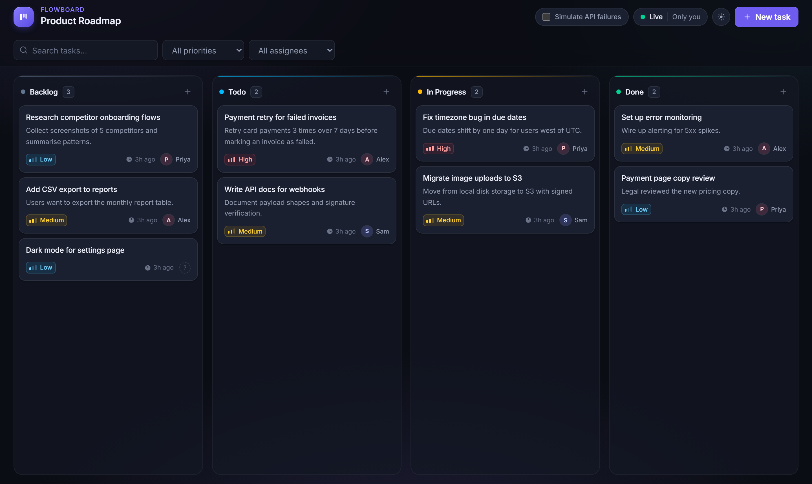
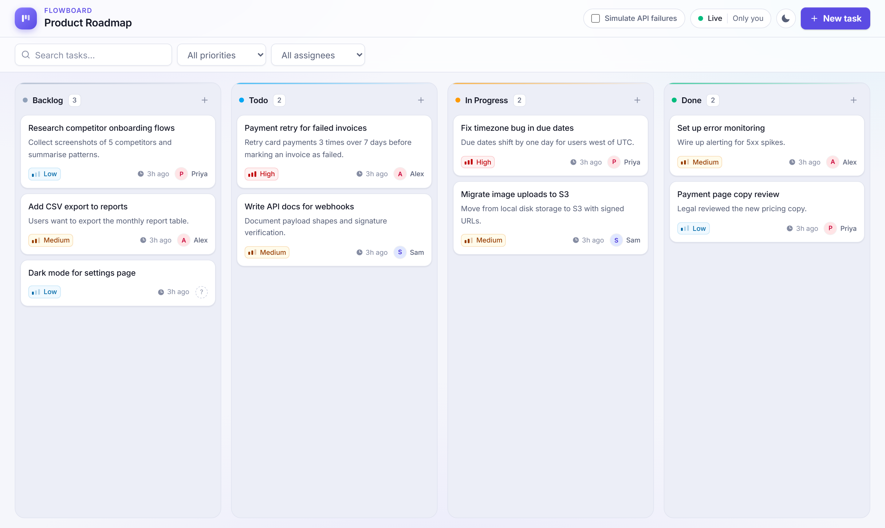
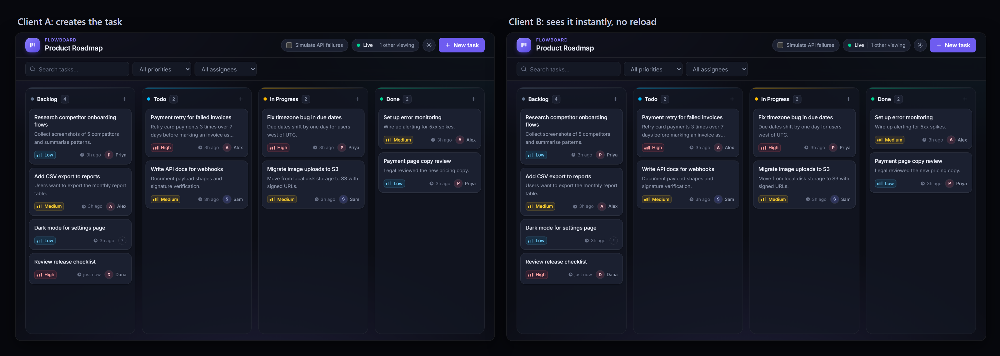
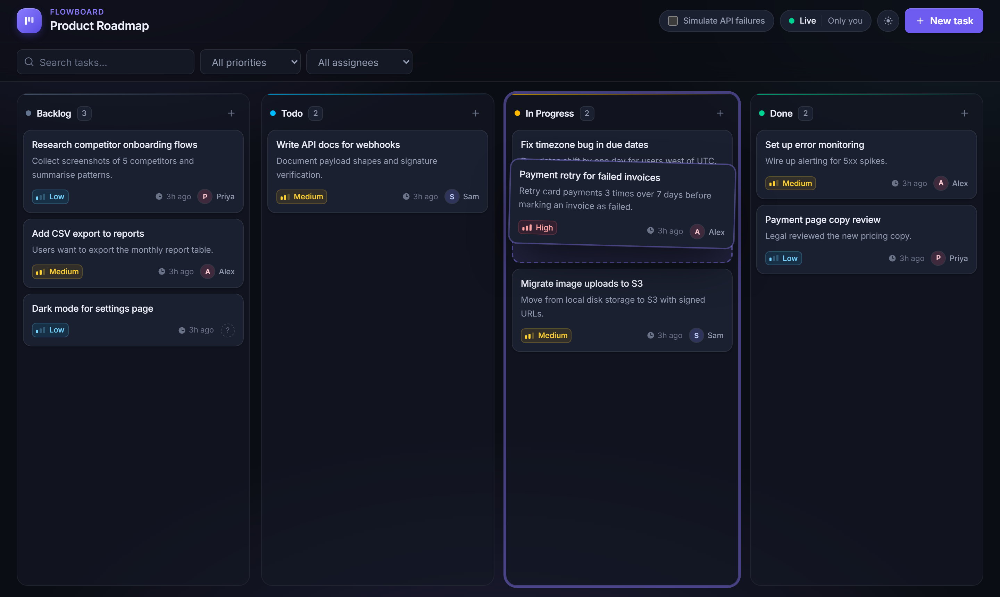
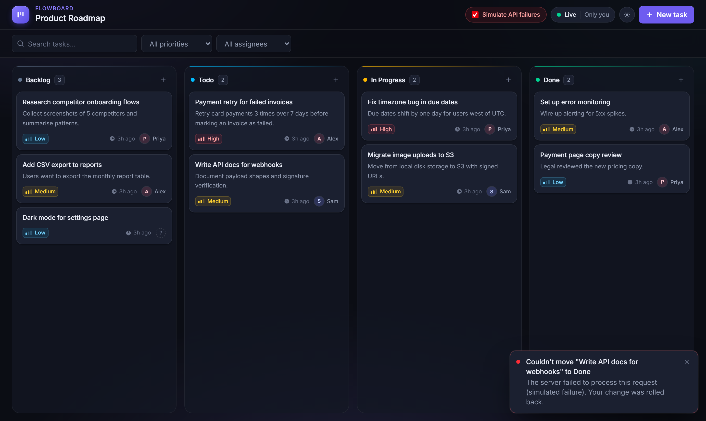
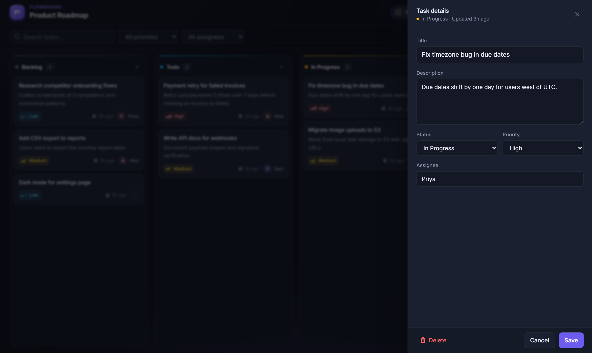
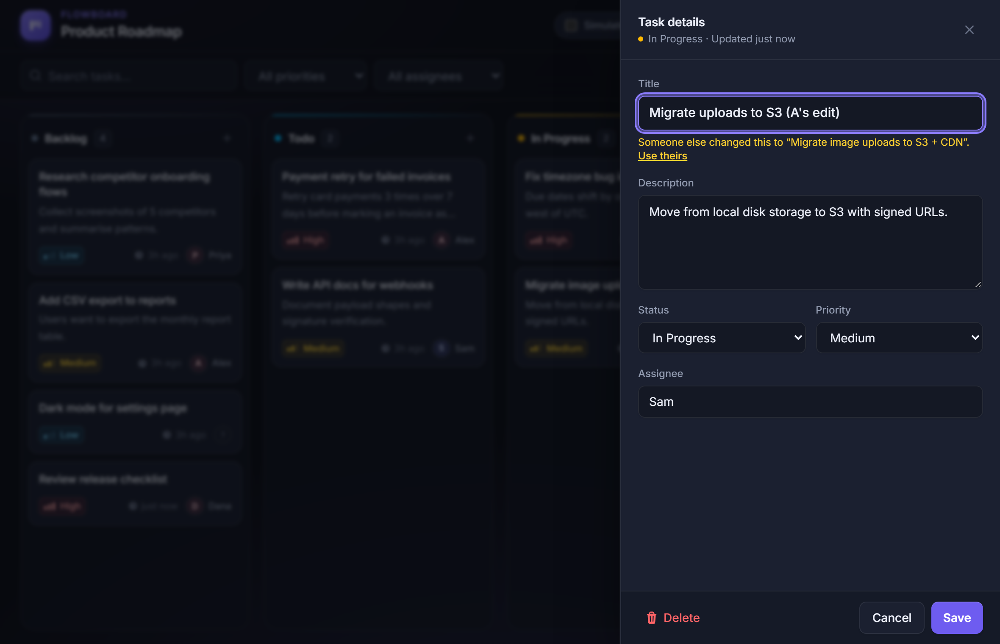
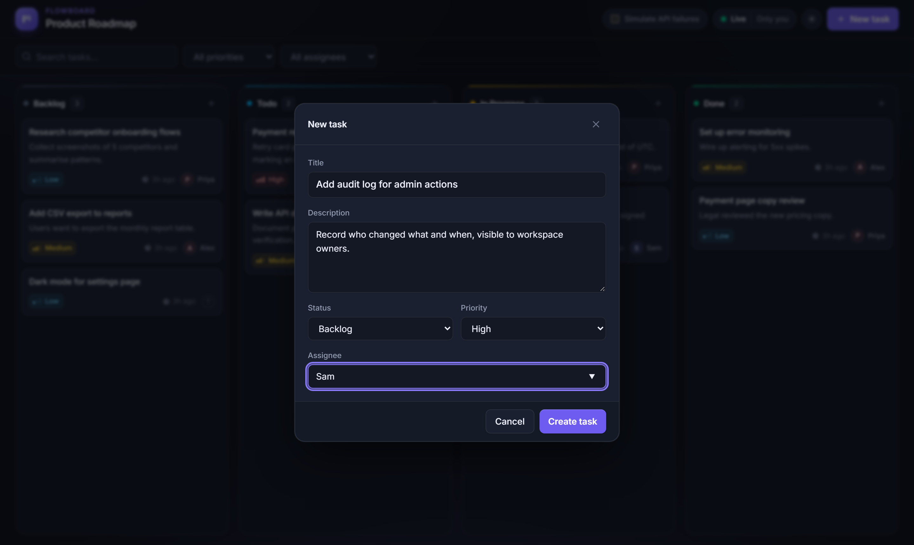
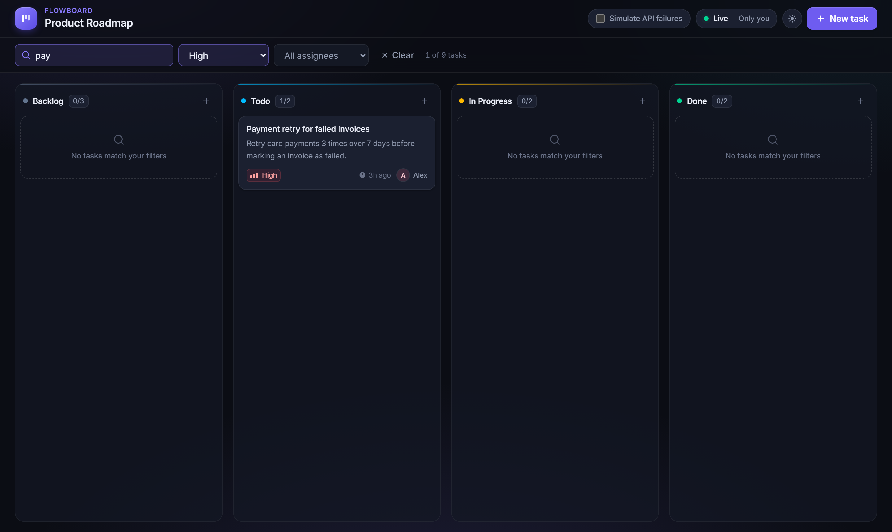
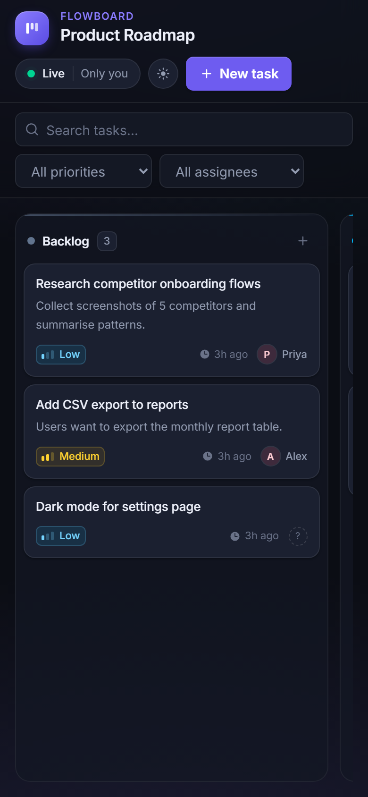

# Flowboard: Collaborative Kanban Board

A real-time collaborative Kanban board. Several people can work on the same board at once: changes appear instantly for the person making them (optimistic UI) and stream to everyone else over Server-Sent Events, without reloading the page.

[](https://github.com/Bala24K/Project-Management-Kanban-board/actions/workflows/ci-cd.yml)

**Live app:** **<https://flowboard-bala.duckdns.org>**

The app runs on AWS: an EC2 server in Sydney running Docker, with an RDS PostgreSQL database, served over HTTPS. Open it in two browser windows to see changes sync in real time. Use the **Simulate API failures** switch in the header to see rollback. [How to try it](#try-it-as-a-user) walks through each feature.

- Four columns in fixed order: **Backlog → Todo → In Progress → Done**
- Create, edit, and delete tasks. Click a card to edit it in a detail drawer.
- Drag and drop between and within columns, with mouse or keyboard. Status and position are persisted.
- Title search plus priority and assignee filters. They combine, sync to the URL, and survive refresh and back/forward.
- Optimistic updates with per-mutation rollback and error toasts
- Real-time sync with mutation-aware reconciliation, so remote events never clobber your pending changes
- Field-level conflict detection (HTTP 409) for concurrent edits of the same field
- A development and demo failure switch for seeing rollbacks
- Dark theme by default and a light theme. The header toggle switches between them, and the choice is remembered across visits.

## Screenshots

**Board (dark theme, the default):** four columns, priority badges, assignees and last-updated times.



**Light theme:** switch with the sun/moon button in the header.



**Real-time collaboration:** a task created in one browser appears in the other instantly, without a reload.



| Drag and drop with an insertion placeholder | Rollback after a failed request |
| --- | --- |
|  |  |

| Task detail drawer | Concurrent edit warning |
| --- | --- |
|  |  |

| Create task | Search and filters, restored from `?search=pay&priority=high` | Mobile |
| --- | --- | --- |
|  |  |  |

## Try it as a user

Open **<https://flowboard-bala.duckdns.org>** in **two browser windows** side by side, for example one normal window and one private window. The header should say **Live · 1 other viewing**.

| # | Feature | What to do | What you should see |
| --- | --- | --- | --- |
| 1 | Create | Click **New task**, fill in the title, priority and assignee, then click **Create task** | The card appears instantly in Backlog, and in the other window too, without a reload |
| 2 | Edit | Click a card, change the description, priority, assignee or status, then click **Save** | The card updates immediately, in both windows |
| 3 | Drag between columns | Drag a card from Todo to In Progress | A dashed placeholder shows where it will land. The other window shows the move. |
| 4 | Reorder | Drag a card above another card in the same column, then refresh the page | The new order stays after the refresh (it's saved in the database) |
| 5 | Keyboard drag | Tab to a card, press **Space**, use the arrow keys, then press **Space** again | The card moves without a mouse. **Enter** opens the details. |
| 6 | Search and filters | Type in the search box, then pick a priority and an assignee | Only matching cards show, and the URL becomes `?search=…&priority=…&assignee=…` |
| 7 | URL state | Refresh the page, then press the browser's Back button | The filters are restored after the refresh, and Back returns to the previous filters |
| 8 | Rollback | Tick **Simulate API failures**, then drag a card or edit a task | The change appears, then reverts, with an error message saying it was rolled back. Untick the box when done. |
| 9 | Concurrent edit | In window A, open a task and change its title without saving. In window B, rename the same task and save. | Window A keeps your typed text and shows "Someone else changed this… Use theirs". Saving in A shows a conflict message. |
| 10 | Remote delete | Open a task in window A, then delete it in window B | Window A's drawer says "This task was deleted" |
| 11 | Reconnect | Turn off your Wi-Fi for a few seconds, then turn it back on | The indicator shows **Reconnecting…**, then **Live**, and changes made meanwhile appear |
| 12 | Theme | Click the sun/moon button in the header, then refresh | The app switches between dark and light, and stays on your choice after the refresh |

### Command cheat-sheet

Full details are in [Running locally](#running-locally) and [Scripts](#scripts).

```bash
# Run locally (needs Node 20+ and PostgreSQL)
npm install
cp .env.example apps/api/.env      # set DATABASE_URL
npm run db:migrate                 # create tables
npm run db:seed                    # optional demo data
npm run dev                        # http://localhost:5173

# Check and test
npm run typecheck                  # TypeScript, all packages
npm test                           # API (real Postgres) + web tests
npx playwright install chromium    # once
npm run test:e2e                   # browser tests, real API + DB, two clients

# Production
npm run build && npm run db:deploy && npm start     # http://localhost:4000

# Check the live deployment
curl https://flowboard-bala.duckdns.org/api/health
curl -N https://flowboard-bala.duckdns.org/api/events    # live event stream (Ctrl+C to stop)
```

---

## Tech stack

| Layer | Choice |
| --- | --- |
| Frontend | React 19, TypeScript, Vite 7, Tailwind CSS 4, dnd-kit |
| Backend | Node.js, Express 5, TypeScript, Prisma 6, PostgreSQL 16 |
| Real-time | Server-Sent Events (native `EventSource`) |
| Validation | Zod 4 schemas shared by client and server |
| Tests | Vitest, Supertest (against real Postgres), Testing Library, Playwright (real API + DB, two browser contexts) |
| Repo | npm workspaces monorepo |

## Architecture

```text
apps/
  api/                    Express API (also serves the built frontend in production)
    prisma/               schema, migrations, seed
    src/
      routes/             HTTP layer: board, tasks, events (thin; broadcast after commit)
      services/           TaskService: business rules + DB transactions
      events/             EventHub: SSE connections, heartbeats, replay buffer
      middleware/         error handler, failure simulation, client/mutation ids
      lib/                config, prisma client, errors, serialisation
    test/                 API + SSE tests (real Postgres)
  web/
    src/
      features/board/     boardState (reducer), useBoard (single state owner), Board/Column/TaskCard, DnD helpers
      features/tasks/     detail drawer, create dialog
      features/filters/   filter logic, URL sync, filter bar
      features/collaboration/  EventSource wrapper, connection indicator
      components/, lib/   UI primitives, API client, time helpers
packages/
  shared/                 Task type, Zod schemas, event types, column constants
e2e/                      Playwright tests
```

### Data model and ordering

- `Task` has `id` (uuid), `title`, `description`, `priority` (enum), `assignee`, `status` (enum), `position`, `revision`, `createdAt` and `updatedAt`.
- Database CHECK constraints enforce `position >= 0`, a non-blank title, and `revision >= 0`.
- `position` is **dense and 0-based within each column** (0..n-1).
- Every write runs in one transaction that:
  1. Bumps `Board.revision` with `UPDATE … RETURNING`. The row lock **serialises writers**, and the value is a monotonic **sequence number**.
  2. Applies the change.
  3. Renumbers the affected column(s) in a single `UPDATE … FROM unnest(…) WITH ORDINALITY`.
- Renumbering only touches `position`. Tasks that were merely shifted don't get a new `revision` or `updatedAt`.
- Clients send moves as a **target index** (`PATCH {status, position}`). The server clamps it and returns the authoritative order of every column it touched.

### API

| Method | Path | Success | Errors |
| --- | --- | --- | --- |
| GET | `/api/board` | 200 `{ board, tasks, revision }` | 500 |
| POST | `/api/tasks` | 201 `{ task, order, revision }` | 400, 409 (duplicate id) |
| PATCH | `/api/tasks/:id` | 200 `{ task, order, revision }` | 400, 404, 409 (conflict) |
| DELETE | `/api/tasks/:id` | 204 | 404 |
| GET | `/api/events` | `text/event-stream` | n/a |
| GET | `/api/health` | 200 | n/a |

- All errors share one shape: `{ "error": { "code", "message", "details?", "current?" } }`.
- Request bodies are validated with the shared Zod schemas. Unknown fields are rejected.
- Requests may carry `X-Client-Id` and `X-Mutation-Id`. These are echoed in the broadcast event.

**SSE events:** `task.created`, `task.updated`, `task.deleted`, plus `hello`, `presence` (connection count) and `resync`. Each task event has these fields:

```json
{ "type": "task.updated", "taskId": "…", "task": { … }, "order": { "todo": ["…"], "done": ["…"] },
  "revision": 42, "timestamp": "…", "clientId": "…", "mutationId": "…" }
```

- The SSE `id:` is the board revision.
- The server sends a heartbeat comment every 15 s.
- A ring buffer of recent events replays anything a client missed when it reconnects with `Last-Event-ID`. If the gap is older than the buffer, the server sends `resync` and the client refetches the board.
- Events are published **only after the transaction commits**. A failed operation (404, 409, 400, DB error, simulated failure) never broadcasts, and tests cover this.

---

## How optimistic updates and rollback work

All board state lives in one reducer ([`boardState.ts`](apps/web/src/features/board/boardState.ts)). Components only call intent methods (`createTask`, `updateTask`, `moveTask`, `deleteTask`) on [`useBoard`](apps/web/src/features/board/useBoard.ts).

The state has two layers:

```text
confirmed : tasks exactly as the server last told us (HTTP responses + SSE events)
pending   : ordered queue of local mutations not yet confirmed
view      = replay(pending) on top of confirmed
```

1. **Optimistic:** a mutation is pushed onto `pending`, so the UI changes in the same render. A spinner marks cards that are saving.
2. **Request:** it's sent with a `mutationId`. Mutations on the same task are sent sequentially, in order, and creates use a client-generated uuid, so later edits can't race ahead of the create.
3. **Success:** the server result (task + authoritative column order) is folded into `confirmed`, and the mutation is removed in the same reducer step, so there's no flicker.
4. **Failure:** only that mutation is removed from `pending`, and a toast explains what failed ("…Your change was rolled back."). Because the view is recomputed from `confirmed` plus the remaining mutations:
   - There's no snapshot to restore, so **an older failure can never undo a newer successful mutation** or a remote change that arrived in the meantime.
   - A failed create leaves **no phantom task**, and a failed move leaves **no wrong positions**.
   - On 404 the task is marked deleted. On 409 the server's current version is adopted.

Drag and drop renders a local preview while dragging. **Exactly one request is sent, on drop.** When the board is filtered, the drop index is translated from the visible list to the full column by placing the task next to its visible neighbour.

## How real-time events avoid overwriting local changes

Each browser tab gets a random **client id**. It's sent on the SSE connection and with every write, along with a **mutation id**.

1. **Remote events only touch the `confirmed` layer.** Pending local mutations are re-applied on top. So if someone else edits a task you're dragging or saving, your optimistic version stays on screen. Fields you didn't touch still show their latest remote values.
2. **When your mutation settles,** the view reconciles automatically:
   - Success: the server result has a newer revision and wins.
   - Failure: you see the latest remote state, not the stale pre-edit snapshot.
3. **Your own echo isn't treated as a new change.** It has the same revision as your HTTP response, so applying it is idempotent, whichever arrives first.
4. **Stale events are dropped:**
   - Task data applies only if `event.task.revision` > the known revision.
   - Column order applies only if the event revision > the last order applied to that column.
   - Anything at or below the snapshot revision is ignored. The client attaches the SSE stream *before* fetching the snapshot and buffers events until the snapshot lands, so nothing falls in between.
5. **Deletions are final.** Deleted ids are tombstoned, so a late update, a pending local edit, or a racing snapshot can't resurrect a deleted task.

SSE doesn't solve concurrent writes by itself, so the server also checks for conflicts:
- **Field-level compare-and-set:** when you save from the detail drawer, the client sends the values your edit was based on (`expected`). The server returns **409** only if *another user changed one of the same fields* to something else in the meantime. Edits to different fields merge.
- While the drawer is open, remote changes update untouched fields live. A field you're editing that changes remotely shows a "Someone else changed this… Use theirs" warning.
- Drag-and-drop moves are last-writer-wins. The server serialises them, so positions always stay consistent.

## Failure simulation

- When `FAILURE_SIMULATION=true` (the default outside production), the header shows a **"Simulate API failures"** toggle.
- While the toggle is on, every create, update, move and delete request carries `X-Simulate-Failure: 1`. The server answers **503 before touching the database**, so you can watch the rollback.
- `FAILURE_RATE` (0..1) optionally adds random write failures for soak testing.
- `SIMULATED_LATENCY_MS` delays writes, which makes optimistic updates easy to see.
- In production the toggle is hidden and the header is ignored unless `FAILURE_SIMULATION=true` is set explicitly.

---

## Running locally

Prerequisites: Node 20+ and a PostgreSQL 14+ database. Docker is the easiest way to get one.

```bash
# 1. Postgres (any instance works; this one listens on 5434)
docker run -d --name kanban-pg -e POSTGRES_USER=kanban -e POSTGRES_PASSWORD=kanban \
  -e POSTGRES_DB=kanban -p 5434:5432 postgres:16-alpine

# 2. Install (also builds the shared package and generates the Prisma client)
npm install

# 3. Configure
cp .env.example apps/api/.env          # adjust DATABASE_URL if needed

# 4. Database
npm run db:migrate                     # prisma migrate dev (creates tables)
npm run db:seed                        # optional demo tasks

# 5. Run API (:4000) and web (:5173, proxies /api to the API)
npm run dev
```

Open <http://localhost:5173>. Open a second browser window, or a private window, to see real-time collaboration.

### Environment variables (`apps/api/.env`)

| Variable | Default | Purpose |
| --- | --- | --- |
| `DATABASE_URL` | (required) | PostgreSQL connection string |
| `PORT` | `4000` | HTTP port |
| `CORS_ORIGINS` | empty | Comma-separated allowed origins. Only needed if the frontend is hosted on a different origin. |
| `FAILURE_SIMULATION` | `true` in dev, `false` in prod | Enables the failure toggle / `X-Simulate-Failure` header |
| `FAILURE_RATE` | `0` | Random failure probability for writes |
| `SIMULATED_LATENCY_MS` | `0` | Artificial write latency |
| `SSE_HEARTBEAT_MS` | `15000` | Heartbeat interval |
| `VITE_API_URL` (web, build time) | empty | API base URL if not same-origin |

### Scripts

| Command | What it does |
| --- | --- |
| `npm run dev` | API (tsx watch) + Vite dev server |
| `npm run build` | Build shared, web and API |
| `npm start` | Start the production server (serves `apps/web/dist` too) |
| `npm run db:migrate` / `db:deploy` | Prisma migrate (dev) / apply migrations (prod) |
| `npm run db:seed` | Seed demo tasks (`-- --force` to reset) |
| `npm run typecheck` | TypeScript across all workspaces |
| `npm test` | API tests (real Postgres) + web unit and component tests |
| `npm run test:e2e` | Playwright against a real API + Postgres |

**Test databases:**
- API tests use `kanban_test`, overridable with `TEST_DATABASE_URL`.
- E2E tests use `kanban_e2e`, overridable with `E2E_DATABASE_URL`.

Create both databases once (`CREATE DATABASE kanban_test; CREATE DATABASE kanban_e2e;`). Migrations are applied automatically. Run `npx playwright install chromium` once before the first e2e run.

## Testing

| Suite | Count | What it covers |
| --- | --- | --- |
| API (`apps/api/test`) | 41 tests | Board retrieval, CRUD, validation (400), missing ids (404), duplicate ids and conflicts (409), reorder and cross-column moves with dense positions, concurrent moves, shifted tasks keep their revision, SSE headers, multi-client broadcast with client and mutation ids, presence and cleanup on disconnect, `Last-Event-ID` replay, resync on gap, heartbeats, frame serialisation, **no broadcast** after 404/409/400/503/DB exception |
| Web (`apps/web/src`) | 45 tests | Reducer: optimistic apply, rollback, overlapping mutations, remote events vs pending mutations, own echo, stale events, tombstones, resync. Filters and URL parse/serialise. DnD index translation. App: four columns in order, skeleton, create/edit/delete optimistic and rollback, failure toggle, remote SSE create/update/delete, pending edit not overwritten, stale events ignored, reconnecting state, URL restore and back/forward. |
| E2E (`e2e/`) | 7 tests | Two independent browser contexts on a real API + DB: create, see, edit, receive, drag to another column, see status and position, forced failure, rollback. Reorder within a column persists across reload. Keyboard move. Failed drag rollback. Combined filters, URL, refresh, back/forward. Concurrent same-field edit gives 409 and local edit protection. Remote delete while the drawer is open. |

## Deployment

The app deploys as **one service**: the Express API also serves the built React app, so there's no CORS and a relative `/api` URL. The database is managed PostgreSQL.

- **AWS (EC2 + RDS), the setup used for the live app:** see the step-by-step guide in [docs/DEPLOY_AWS.md](docs/DEPLOY_AWS.md). The live app at <https://flowboard-bala.duckdns.org> consists of:
  - a `t3.micro` EC2 instance with an Elastic IP, running the Docker image,
  - **Caddy** in front of the app, which provides automatic Let's Encrypt HTTPS and redirects HTTP to HTTPS,
  - a free DuckDNS domain pointing at the Elastic IP,
  - an RDS PostgreSQL `db.t4g.micro` database, reached privately over SSL.
- **Docker:** `docker build -t flowboard .`, then run it with `DATABASE_URL` set. The container runs `prisma migrate deploy` and then `node dist/server.js`.
- **Render (blueprint included):** in the dashboard choose *New → Blueprint*, then pick this repo. [`render.yaml`](render.yaml) creates the web service and a Postgres database and wires up `DATABASE_URL`.
- **Other hosts** (Railway, Fly.io, …): build with `npm ci && npm run build`, start with `npm run db:deploy && npm start`, and set `DATABASE_URL`.

### CI/CD (GitHub Actions)

[`.github/workflows/ci-cd.yml`](.github/workflows/ci-cd.yml) runs on every push and pull request:

1. **test:** `npm ci`, typecheck, the API and web tests against a Postgres service container, then the Playwright e2e suite. Traces are uploaded if a test fails.
2. **deploy** (only on `main`, after the tests pass): SSHes into the EC2 server and runs [`scripts/deploy.sh`](scripts/deploy.sh) for the exact tested commit. The script:
   - builds the new image while the old version keeps serving,
   - swaps the container,
   - waits for `/api/health`,
   - **rolls back automatically** if the new version is unhealthy.

   The job then checks the public URL. Deploys never overlap.

Documentation-only pushes (`*.md`, `docs/`) skip the pipeline. Setup takes two repository secrets, `EC2_SSH_KEY` and `EC2_HOST`; see [docs/DEPLOY_AWS.md](docs/DEPLOY_AWS.md#step-10-optional-automatic-deploys-with-github-actions).

**SSE through proxies:** responses set `Cache-Control: no-cache, no-transform` and `X-Accel-Buffering: no`. The heartbeat keeps idle connections alive, and the browser reconnects automatically with `Last-Event-ID`.

## Status

**Complete:** every requirement in the brief. That covers the board, CRUD, drag-and-drop with persistence, search and filters, the detail drawer, optimistic updates with rollback, real-time collaboration, and URL state. Field-level conflict detection, failure simulation and presence count are also done.

**Not done / known limitations:**
- **Single instance only.** The SSE hub and replay buffer are in-process. Running several instances would need a shared bus such as Postgres `LISTEN/NOTIFY` or Redis.
- The presence count counts **open connections (tabs)**, not distinct people. There's no authentication.
- Drag moves are last-writer-wins, with no conflict prompt. Only drawer edits are compare-and-set checked.
- While a drag is in progress, the dragged column view is frozen. Remote changes show up after the drop.
- `npm audit` reports advisories in dev and migration-time dependencies (Vitest's `tinypool`, and the Prisma CLI's config loader). Fixing them needs major-version upgrades (Vitest 4, Prisma 7+), which were deferred.

## Coding agents used

**Claude Code** (Anthropic) was used as a coding agent, mainly for frontend work:

- React UI components: board, columns, task cards, task detail drawer, create-task dialog, filter bar, connection indicator, toasts and loading skeletons.
- Tailwind CSS styling, the dark/light theme system (CSS design tokens), visual polish and responsive layout.
- dnd-kit drag-and-drop wiring: pointer and keyboard sensors, insertion placeholder and drag overlay.
- Frontend component tests (Vitest + Testing Library).

I planned, specified and directed the project:

- the requirements and API contract,
- the architecture and monorepo layout,
- the data-model and task-ordering rules,
- the requirements for optimistic updates and real-time reconciliation,
- the testing requirements and the engineering quality gates (tests, type checks and builds after every stage).

All agent output was checked against the test suites, which run on the real backend and database, and against the requirements before it was accepted.
